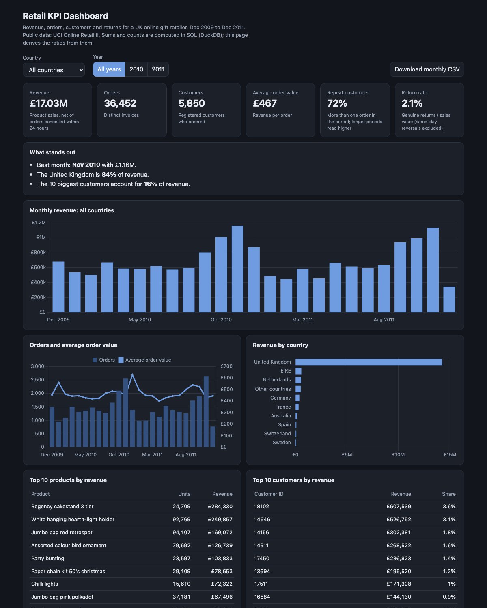

# Retail KPI Dashboard

[](https://github.com/MaHmOuDeB/retail-kpi-dashboard/actions/workflows/ci.yml)


An interactive sales dashboard for a UK online gift retailer, Dec 2009 to Dec 2011: revenue, orders, customers, average
order value, repeat-customer rate and return rate, filterable by country and year, with year-on-year change, top products,
top customers and a CSV export.

**[Open the live dashboard](https://mahmoudeb.github.io/retail-kpi-dashboard/)**



*Rebuilt in 2026 from my Master's project "Sales KPI Dashboard" (2023). The original was a Power BI file, which only opens
in Power BI Desktop on Windows. This version is a web page anyone can open, and the KPI logic is written in SQL.*

## What the data says

- **Revenue slipped slightly year on year.** January to November 2011 revenue was £7.52M versus £7.62M in 2010 (-1.3%), with
  2.8% fewer orders and a 1.5% higher average order value.
- **Returns were steady.** Genuine returns were 2.1% of sales in Jan to Nov 2010 and 2.2% in 2011.
- **Strong seasonality.** November is the best month in both years (£1.16M in 2010, £1.13M in 2011).
- **Concentrated in one market and a few accounts.** The United Kingdom is 84% of revenue; the 10 largest customers are 16%.

## Data cleaning that changes the answer

A cancellation that undoes an order line for the same customer, product and quantity within 24 hours is treated as an order
that never happened, and both lines are removed. Without this rule, two orders (£77k in January 2011 and £168k on 9 December
2011, each cancelled the same day) counted as revenue and again as returns, which made returns look as if they had grown by
29% and put one cancelled order at the top of the product and customer rankings. The rule is tested on synthetic invoices.

## How it works

1. `sql/01_clean.sql` cleans the raw invoice lines: drops lines without a customer ID, separates cancellations, keeps real
   products only and removes orders cancelled within 24 hours.
2. `sql/02_kpis.sql` pre-aggregates sums and distinct counts (revenue, orders, customers, units, returns), top products and top
   customers in DuckDB, once for every country and year, so distinct counts are exact for any filter. The page then derives the
   ratios (average order value, return rate, year-on-year change, shares) from those figures.
3. `src/build_data.py` writes the result to `docs/data.json` (about 130 KB).
4. `docs/index.html` is a static page (Chart.js) that reads that file. There is no server and no build step, so it runs on
   GitHub Pages. It follows the system light or dark theme, works on a phone, and has keyboard focus styles and chart labels.
5. `tests/` checks that country figures add up to the total, that rankings are ordered and that rates are valid.

## KPI definitions

| KPI | Definition |
|---|---|
| Revenue | Quantity x unit price on real product lines (postage, fees and manual adjustments excluded), net of orders cancelled within 24 hours |
| Orders | Distinct invoices |
| Customers | Distinct registered customers who ordered in the period |
| Average order value | Revenue / orders |
| Repeat customers | Share of customers with more than one order in the period |
| Return rate | Value of cancellations that were not same-day reversals / sales value |
| Year-on-year change | 2011 versus 2010 for January to November, the months both years have in full |

## Limits

- 23% of invoice lines have no customer ID, so customer counts and repeat rates describe registered customers only.
- No cost data in the source, so there is no margin view (the original Power BI project had one).
- December 2011 is a partial month (the data ends on 9 Dec); it is marked with * on the charts.
- Returns carry no country, so each takes its customer's main country (the one with the most revenue).
- Customers can order from more than one country, so country customer counts are not strictly additive.
- The 24-hour reversal window is a judgement call.
- The repeat-customer rate depends on the period length (30% for Dec 2009, 66% for 2010, 72% over all years), so compare it only across the same period.

## Reproduce

```bash
make setup   # pip install -r requirements.txt
make data    # downloads UCI Online Retail II (45 MB) and converts it to Parquet
make build   # runs the SQL, rewrites docs/data.json
make serve   # http://localhost:8000
make test
```

Data: Chen, D. (2012). Online Retail II. UCI Machine Learning Repository, CC BY 4.0.
